# 🚀 Awesome Automated Regression Test Suites

  
  
  
  

**A curated index of top-tier automated regression testing platforms, enterprise test suites, frameworks, and developer tools for continuous quality assurance and zero-breakage CI/CD delivery.** ⚡

Automated regression testing ensures that rapid code commits, deep architecture refactors, feature additions, and critical bug fixes never break existing user workflows. Whether executing full end-to-end (E2E) UI testing 🖥️, API regression monitoring 📡, cross-browser validation 🌐, mobile test suites 📱, or performance regression benchmarking ⏱️, selecting the optimal testing ecosystem is critical for engineering velocity and release confidence.

---

## 📑 Table of Contents

- [📊 Sector Overview & Market Dynamics](#-sector-overview--market-dynamics)
- [💼 SaaS & Enterprise Regression Testing Platforms](#-saas--enterprise-regression-testing-platforms)
- [🔓 Open-Source Test Automation Frameworks](#-open-source-test-automation-frameworks)
- [🧠 Local AI Regression Agents](#-local-ai-regression-agents)
- [🎯 Key Evaluation Criteria](#-key-evaluation-criteria)
- [📈 Star History](#-star-history)
- [🤝 Contributing](#-contributing)
- [💖 Support & Sponsorship](#-support--sponsorship)

---

## 📊 Sector Overview & Market Dynamics

The global automation testing market is valued at approximately **$25B to $35B** (projected to reach over **$80B+** by the early 2030s at a CAGR of ~14–16%), propelled by widespread DevOps adoption, continuous delivery pipelines, and AI-driven autonomous test generation. 📈

The sector exhibits **moderate fragmentation**: enterprise test suite portfolios and mission-critical ERP/legacy ecosystems remain concentrated around a handful of heavyweight incumbents and consolidators (such as Tricentis, Postman, and SmartBear), while web, mobile, and cloud-native testing remain highly fragmented with innovative SaaS challengers and ubiquitous open-source developer tooling competing for engineering mindshare. 🧩

---

## 💼 SaaS & Enterprise Regression Testing Platforms

| Platform | Company Valuation / Revenue | Pricing (Starting Tier) | Free Tier / Trial Limits | Primary Testing Focus |
|---|---|---|---|---|
| **[Postman](https://www.postman.com/)** 📮 | **$5.6B Valuation** (~$313M ARR) | **$14/user/month** (Basic) billed annually; Solo at $19/user/month; Unlimited collection runs across all plans | **Free forever plan**: Unlimited collection runs, 3 active integrations, up to 10,000 public API requests/month, and community workspace access | API regression testing, continuous contract testing & automated monitoring |
| **[Tricentis (Tosca)](https://www.tricentis.com/products/automate-continuous-testing-tosca)** 🏢 | **$4.5B Valuation** (~$500M ARR) | **€20,000/year** (~$22,000/year) baseline enterprise license for Tosca Commander & base engine | **14-day free trial**: Full platform evaluation license upon sales approval; no permanent free tier | Model-based enterprise regression automation across SAP, Salesforce, web, and legacy tech |
| **[Testim](https://www.testim.io/)** *(Tricentis)* 🤖 | **$4.5B Valuation** (Part of Tricentis, ~$500M ARR) | **$450/month** (Starter tier for parallel execution & cloud grid) | **Free Community tier**: 1,000 free web test runs/month, 1 local runner slot, chrome-only execution | AI-augmented low-code UI regression testing and self-healing web locator suite |
| **[mabl](https://www.mabl.com/)** 🧠 | **$380M Valuation** (~$25M ARR) | **$450/month** (Core web automation tier, annual contracts) | **14-day free trial**: Unlimited tests, full access to cloud browser execution & self-healing analytics without credit card | Intelligent low-code E2E test automation with auto-healing assertions & performance insights |
| **[Cypress Cloud](https://www.cypress.io/pricing)** 🌲 | **$255M Valuation** (~$18M ARR) | **$75/month** (Team plan, 50,000 test results/month) | **Free forever plan**: 50 test results/month, 3 user seats, and GitHub integration; OSS projects get up to 100K results/month | Fast component and E2E regression test recording, flakiness detection & parallelization |
| **[Katalon Studio](https://katalon.com/)** 🧪 | **$45M ARR** ($30M+ raised) | **$229/seat/month** ($1,000/seat/year for first 3 seats) | **30-day free trial**: Full Enterprise functionality; free community plan with 2,000 execution quota limit | All-in-one test automation platform for Web, API, Mobile, and Desktop regression suites |
| **[Ranorex Studio](https://www.ranorex.com/)** 🖥️ | **$10M ARR** (Division of Idera, Inc.) | **$650/user/year** (Studio Node-Locked perpetual base starting tier) | **14-day free trial**: Full access to Ranorex Studio desktop, mobile, and web testing suite | Robust desktop, web, and legacy client GUI automated regression testing |
| **[Ghost Inspector](https://ghostinspector.com/)** 👻 | **Bootstrapped / Acquired** (SureSwift Capital) | **$109/month** billed annually ($125 billed monthly, 10,000 test runs) | **14-day free trial**: Full Scale plan functionality with unlimited test runs during evaluation; no credit card required | No-code browser recording, visual regression diffing, and schedule-based synthetic monitoring |
| **[PractiTest](https://www.practitest.com/)** 📋 | **Bootstrapped** (Global Enterprise QA) | **$47/user/month** (Team tier, billed annually) | **14-day free trial**: Full QA management orchestration, test suite execution, and issue tracking | Centralized test management, regression orchestration, and end-to-end traceability |

---

## 🔓 Open-Source Test Automation Frameworks

Open-source testing frameworks form the foundation of modern automated regression workflows, empowering engineering teams to build modular, maintainable, and cost-effective test suites without proprietary vendor lock-in. 🛠️

| Framework | Stargazers | Primary Language(s) | Description |
|---|---|---|---|
| **[Playwright](https://github.com/microsoft/playwright)** 🎭 |  | TypeScript, JavaScript, Python, C#, Java | Fast, reliable cross-browser end-to-end testing across Chromium, WebKit, and Firefox with native headless emulation, parallel runs, and trace inspection. |
| **[Cypress](https://github.com/cypress-io/cypress)** 🌲 |  | JavaScript, TypeScript | Developer-friendly front-end automated test runner tailored for modern JavaScript frameworks with real-time reload, time-travel debugging, and automated waits. |
| **[Selenium](https://github.com/SeleniumHQ/selenium)** 🌐 |  | Java, Python, C#, JavaScript, Ruby | The historical industry standard WebDriver specification and ecosystem for automated browser regression suites across all major browsers and platforms. |
| **[k6](https://github.com/grafana/k6)** ⚡ |  | Go, JavaScript | Modern, developer-centric performance and regression load testing tool designed for engineering teams and cloud-native microservices. |
| **[Locust](https://github.com/locustio/locust)** 🦗 |  | Python | Scalable user-load and performance regression testing tool written in Python where test scenarios are declared cleanly in standard Python code. |
| **[Appium](https://github.com/appium/appium)** 📱 |  | Cross-language (WebDriver) | Cross-platform mobile automation framework allowing native, hybrid, and mobile web regression testing on iOS and Android. |
| **[Robot Framework](https://github.com/robotframework/robotframework)** 🤖 |  | Python | Generic keyword-driven test automation framework for acceptance testing, acceptance test-driven development (ATDD), and robotic process automation (RPA). |
| **[TestCafe](https://github.com/DevExpress/testcafe)** ☕ |  | JavaScript, TypeScript | Zero-configuration end-to-end web testing platform that runs without WebDriver or browser plugins directly in the browser environment. |
| **[WebdriverIO](https://github.com/webdriverio/webdriverio)** 🚀 |  | JavaScript, TypeScript | Next-generation browser and mobile test automation framework for Node.js built on top of the WebDriver and Chrome DevTools protocols. |

---

## 🧠 Local AI Regression Agents

| Tool | Source / Language | Pricing & License | Regression Workflow |
|---|---|---|---|
| **[agent-qa](https://vostride.com)** | [GitHub](https://github.com/vostride/agent-qa) · TypeScript / Node.js 24+ | $0 software for permitted local use under FSL-1.1-ALv2; model and compute/browser/device costs separate | Natural-language web, Android and iOS regression suites with persistent memidex memory, validated self-improvement, and recorded steps/screenshots. CLI, local dashboard and MCP; configured model and test environment required. [Docs](https://vostride.com/docs/agent-qa). |

---

## 🎯 Key Evaluation Criteria

When selecting an automated regression test suite for your engineering team, evaluate against these benchmarks:

1. **⚡ Test Execution Speed & Parallelization:** Does the tool natively split test suites across cloud runners or worker nodes to keep CI/CD build times under 10 minutes?
2. **🛡️ Maintenance Overhead & Flakiness Prevention:** Does it offer self-healing element locators, smart retries, and comprehensive tracing/artifacts (DOM snapshots, video, HAR logs)?
3. **💻 Execution Environment Coverage:** Does it cover cross-browser (Chromium, Firefox, Safari/WebKit), mobile platforms (Android/iOS), API contracts, and desktop applications?
4. **🔄 Integration Ecosystem:** Compatibility with GitHub Actions, GitLab CI, Jenkins, Jira, and Slack/Teams alerting pipelines.
5. **💰 Total Cost of Ownership (TCO):** Weigh the recurring seat/run cloud costs of SaaS platforms against the engineering maintenance hours required for open-source frameworks.

---

## 📈 Star History

---

## 🤝 Contributing

Contributions are welcome! 🎉 If you would like to suggest a new regression testing platform, framework, or benchmark, please review the [contribution guidelines](CONTRIBUTING.md) and submit a pull request.

---

## 💖 Support & Sponsorship

Thank you for visiting and supporting **Awesome Automated Regression Test Suites**! 🙏

If this resource has helped you or your team evaluate, modernize, or scale your regression testing pipelines, please consider supporting the project:

- ⭐ **Star the repository** to boost discoverability on GitHub.
- 🍴 **Fork and contribute** by adding new tools, updates, or benchmarks.
- 📢 **Share with peers** on Twitter/X, LinkedIn, Reddit, or your engineering tech channels.
- ☕ **Buy a coffee & sponsor the author:** Support ongoing open-source maintenance via the [GitHub Sponsors Dashboard](https://github.com/sponsors/ishandutta2007).
